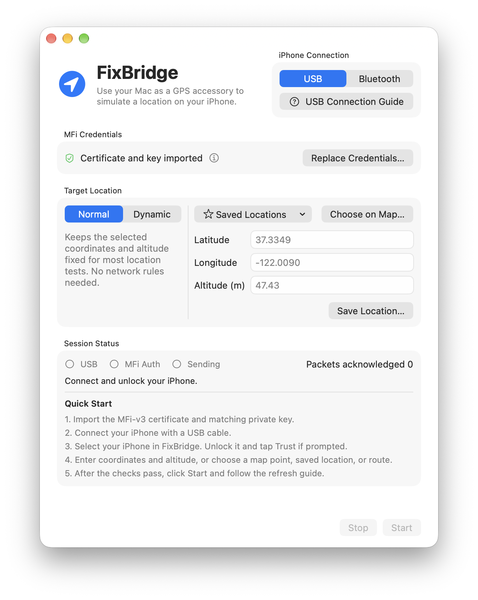

# FixBridge

[简体中文](README.zh-CN.md)

FixBridge is a native macOS app for testing iPhone location behavior. It uses your Mac as a GPS accessory over USB or Bluetooth Classic to send a fixed location, vary it slightly, or replay a GPX route.

## Features

- **Fixed and dynamic locations** — Enter latitude, longitude and altitude, search or pick a point on the map, or choose a saved location. Coordinates accept decimal degrees or degrees, minutes and seconds.
- **GPX playback** — Import, save and preview routes. Start, pause or resume playback, and hold the final position until you stop the session.
- **Ground elevation estimates** — Fill in altitude from terrain data after picking a map point. Edit the estimate if needed, or look up missing elevations when importing a GPX route.
- **Connection and session tools** — USB and Bluetooth setup guides, connection and authentication checks, a location refresh guide, and route progress.
- **Languages** — English, Simplified Chinese, Traditional Chinese (Hong Kong), and Traditional Chinese (Taiwan).

## How it works

FixBridge establishes an iAP2 accessory session and signs the MFi authentication challenge locally using the credentials you import. Once the iPhone requests location updates, FixBridge encodes coordinates and altitude as NMEA data. USB uses macOS MobileDevice and the iPhone’s CarKit accessory service. Bluetooth uses a bundled native RFCOMM component.

iOS decides whether to use the accessory’s position. **Packets acknowledged** measures delivery over the link. Verify the actual position on the iPhone when testing. USB relies on private Apple interfaces, so macOS or iOS updates may affect compatibility.

## Getting started

### Requirements

- A Mac running **macOS 14 Sonoma or later** and Xcode with Swift 6 support to build from source. Release builds target Apple silicon and Intel.
- An iPhone and a USB data cable, or an iPhone paired with the Mac over Bluetooth.
- An MFi-v3 certificate (DER PKCS#7) and its matching private key (unencrypted DER PKCS#8, P-256).

### Find MFi-v3 credentials

One publicly available source of experimental credentials is [DiPlay v0.2.7](https://github.com/shihabal3amri/DiPlay/releases/tag/v0.2.7). Download `DiPlay-0.2.7.apk` from **Assets** and open it as a ZIP archive. Extract these two files from the same APK. You can do this on your Mac without installing DiPlay.

- `assets/offline-mfi/certificate.p7b`
- `assets/offline-mfi/identity.pk8`

Review the credentials’ provenance before use and make sure you are authorized to use them. iOS may stop accepting this experimental identity.

### Build and run

1. Clone or download this repository and open `FixBridge.xcodeproj` in Xcode.
2. Select the **FixBridge** scheme and **My Mac**, then press **⌘R**. The default build uses ad hoc signing for local use.
3. To use your own signing identity, copy [Config/Local.example.xcconfig](Config/Local.example.xcconfig) to `Config/Local.xcconfig` and set your bundle ID, development team and signing identity. Git ignores this local file.

If you are rebuilding an existing installation, keep its bundle ID to retain access to its saved data. For older builds that use the original route library path, set `FIXBRIDGE_LEGACY_BUNDLE_IDENTIFIER` to that same ID in the local configuration.

### Send a test location

1. Click **Import Credentials…** and select the certificate, then its matching key.
2. Connect and unlock your iPhone. With USB, use a data cable and accept the trust prompt if shown. With Bluetooth, pair the iPhone in **System Settings → Bluetooth** on the Mac. Select the connected device in FixBridge.
3. Choose **Normal** for a fixed position and set a target. When the connection and MFi checks pass, click **Start**.
4. Follow the refresh guide. On the iPhone, turn off **Settings → Privacy & Security → Location Services**. In FixBridge, click **I Turned It Off**, wait for the countdown, then turn Location Services back on. Open Maps and recenter on your current position.
5. Click **Stop** to end the session. If Maps still shows the test location, turn Location Services off and back on.

## Dynamic mode and GPX routes

**Dynamic** varies a single point or plays a GPX route. Open the in-app **Network Setup…** guide before testing this mode. It explains how network-based location can affect accessory updates and how to restore your network settings after testing.

Import a GPX file up to 8 MB containing one track segment or one route. It needs at least two points with valid coordinates and strictly increasing timestamps. Playback uses the intervals between points. Importing automatically saves the route to your library. You can prepare a file with an external editor such as [gpx.studio](https://gpx.studio/).

Click **Start** and refresh the iPhone location. After confirming the phone has reached the first point, click **Start Route**. You can pause and resume playback from the same control. The map preview’s coordinate setting only affects the display.

Single-point sessions run for up to one hour. Route sessions keep sending the final point until stopped or disconnected.

## Troubleshooting and privacy

- **iPhone missing from the list** — For USB, unlock the phone, check whether Finder detects it, and try a direct connection with another data cable. For Bluetooth, check pairing in System Settings and refresh the device list.
- **Packets arrive but the location does not change** — Try **Refresh iPhone Location…**. If it still fails, stop the session, restart the iPhone and reconnect. The guide also works with manual navigation to Settings. Automatic navigation requires Xcode device tools and an eligible iPhone connection.
- **Storage and network requests** — Imported credentials stay in the Mac’s Keychain. Saved locations and routes are stored locally. Map display and search use Apple services. Map selections send the chosen coordinates to Open-Meteo to estimate elevation. GPX imports query Open-Meteo for points with missing elevations only after you approve.
- **Reporting an issue** — Include macOS and iOS versions, connection mode, steps to reproduce and a redacted error message. Keep credentials, device identifiers and real routes out of reports.

## Development

See [ARCHITECTURE.md](ARCHITECTURE.md) for the project layout and state boundaries. Run `Tests/run.sh` for regression checks and `python3 Tests/check_sources.py` to check Xcode source registration and localizations. The regression suite uses test doubles for the iPhone connection.

## Credits and license

- USB iAP2 session handling and location encoding were adapted from [aur3l14no/accessory-location](https://github.com/aur3l14no/accessory-location).
- Wireless iAP2 and CarPlay session behavior were researched using [youcci/playport](https://github.com/youcci/playport) as a reference.
- [Apple’s MFi Program](https://mfi.apple.com/en/how-it-works) provides the iAP2 specifications.
- Map preview coordinate conversion is based on [wandergis/coordtransform](https://github.com/wandergis/coordtransform). Terrain estimates use [Open-Meteo](https://open-meteo.com/en/docs/elevation-api) and [Copernicus DEM](https://doi.org/10.5270/ESA-c5d3d65).

FixBridge is distributed under [GPL-3.0-only](LICENSE). See the [third-party notices](FixBridge/Resources/ThirdPartyNotices.txt) and [About credits](FixBridge/Resources/Credits.rtf) for additional attribution.
