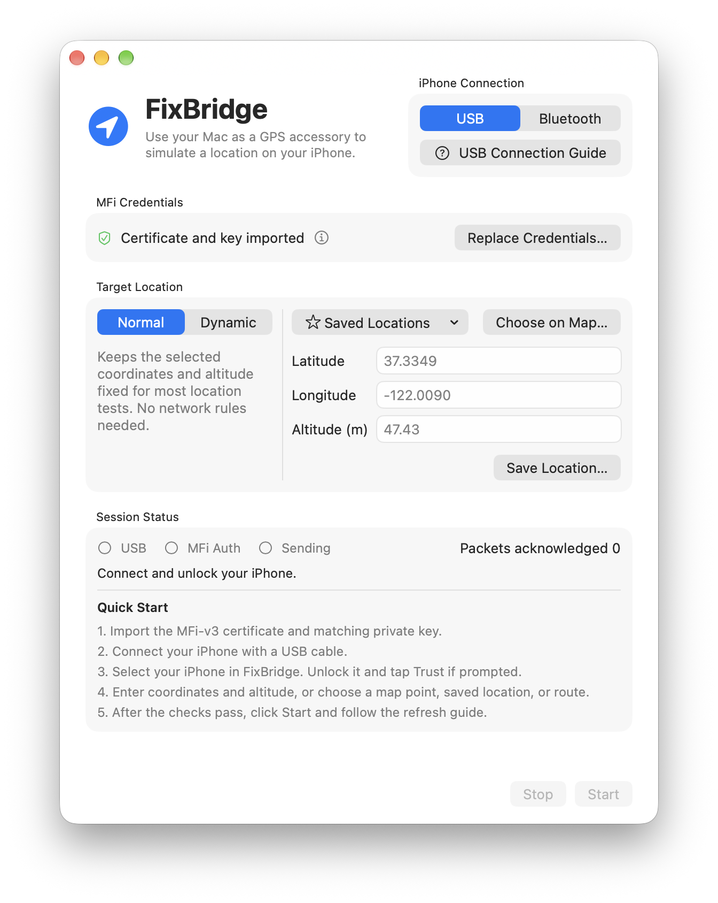

# FixBridge

[English](README.md)

FixBridge 是一款用于测试 iPhone 定位行为的原生 macOS App。它通过 USB 或经典蓝牙，让 Mac 充当 GPS 配件，支持发送固定位置、模拟小范围位置变化和播放 GPX 路线。

## 功能

- **固定位置和动态定位** — 手动输入经纬度和海拔、搜索地点、从地图选点，或使用常用点位。经纬度支持十进制度和度分秒。
- **GPX 路线播放** — 导入并保存路线，在地图上预览，支持开始、暂停和继续。播放结束后保持终点位置，直到停止会话。
- **地面海拔估算** — 地图选点后自动查询海拔，估算值可以手动修改。导入的 GPX 缺少海拔时，也可以查询缺失值。
- **连接与会话工具** — 提供 USB 和蓝牙连接指南、连接与认证检查、定位刷新向导及路线播放进度。
- **语言** — 英文、简体中文、繁体中文（香港）和繁体中文（台湾）。

## 工作原理

FixBridge 与 iPhone 建立 iAP2 配件会话，用导入的凭据在 Mac 本地完成 MFi 挑战签名。iPhone 请求定位更新后，FixBridge 将经纬度和海拔编码为 NMEA 数据并发送。USB 连接使用 macOS 的 MobileDevice 和 iPhone 的 CarKit 配件服务，蓝牙通过内置的原生 RFCOMM 组件连接。

iOS 会自行决定是否采用配件位置。「已确认」计数表示数据已通过链路送达，实际测试结果以 iPhone 上读到的位置为准。USB 方式依赖 Apple 的私有接口，macOS 或 iOS 更新可能影响兼容性。

## 快速开始

### 使用条件

- 运行 **macOS 14 Sonoma 或更新版本**的 Mac。从源码构建需使用支持 Swift 6 的 Xcode。Release 配置支持 Apple 芯片和 Intel。
- 一台 iPhone，以及支持数据传输的 USB 线，或已与 Mac 配对的蓝牙连接。
- 一份 MFi-v3 证书（DER PKCS#7）及其配套私钥（未加密的 DER PKCS#8，P-256）。

### 获取 MFi-v3 凭据

[DiPlay v0.2.7](https://github.com/shihabal3amri/DiPlay/releases/tag/v0.2.7) 的 APK 公开提供了一组实验用凭据。到发布页的 **Assets** 下载 `DiPlay-0.2.7.apk`，在 Mac 上将它作为 ZIP 压缩包打开，从同一个 APK 中提取下面两个文件。整个过程无需安装 DiPlay。

- `assets/offline-mfi/certificate.p7b`
- `assets/offline-mfi/identity.pk8`

使用前请核实这组凭据的来源，并确认你有权使用。后续版本的 iOS 可能不再接受这组实验用凭据。

### 构建并运行

1. 克隆或下载本仓库，在 Xcode 中打开 `FixBridge.xcodeproj`。
2. 选择 **FixBridge** scheme 和 **My Mac**，按 **⌘R**。默认使用临时签名（ad hoc），可在本机运行。
3. 如需自行签名，将 [Config/Local.example.xcconfig](Config/Local.example.xcconfig) 复制为 `Config/Local.xcconfig`，再配置 Bundle ID、开发团队和签名身份。Git 会忽略这份本地配置。

如果重新构建已有安装，请沿用原 Bundle ID，以继续使用已保存的数据。如果旧版使用原始路线库路径，请在本地配置中把 `FIXBRIDGE_LEGACY_BUNDLE_IDENTIFIER` 设为同一个 Bundle ID。

### 发送测试位置

1. 点击「导入认证材料…」，依次选择证书和匹配的私钥。
2. 连接并解锁 iPhone。使用 USB 时，接上数据线并按提示信任电脑。使用蓝牙时，先在 Mac 的「系统设置 → 蓝牙」中配对。然后在 FixBridge 中选择 iPhone。
3. 选择「普通」，输入坐标和海拔、从地图选点或选择常用点位。连接和 MFi 检查通过后，点击「开始定位」。
4. 按向导在 iPhone 上进入「设置 → 隐私与安全性 → 定位服务」并关闭开关。在 FixBridge 点击「我已关闭定位服务」，倒计时结束后重新打开，再回到地图点按「当前位置」。
5. 点击「停止」结束会话。若地图仍显示测试位置，关闭定位服务后再重新打开。

## 动态模式与 GPX 路线

「动态」模式可以在单点附近模拟轻微变化，也可以播放路线。开始前打开 App 内的「网络设置…」指南，了解网络定位可能怎样影响配件更新，以及测试结束后如何恢复网络设置。

导入的 GPX 文件最大为 8 MB，可包含一段轨迹或一条路线。每条路线至少有两个点，各点必须有有效坐标和严格递增的时间戳。播放节奏由相邻点的时间间隔决定。导入成功后，路线会自动保存。可用 [gpx.studio](https://gpx.studio/) 等编辑器制作 GPX 文件。

点击「开始定位」并完成刷新后，先在 iPhone 上确认当前位置已到起点，再点击「播放路线」。播放时可用同一个按钮暂停或继续。预览窗口的「地图坐标」选项仅影响地图显示。

单点会话最长运行一小时。路线播放结束后会继续发送终点，直到手动停止或连接断开。

## 排查问题与隐私

- **列表中没有 iPhone** — USB 模式下先解锁 iPhone，确认 Finder 能否识别，必要时换一根数据线直连 Mac。蓝牙模式下在 Mac 系统设置确认配对，再刷新设备列表。
- **有回执，位置却没变** — 点击「刷新 iPhone 定位…」。如果仍无效，停止会话，重启 iPhone 后重新连接。自动跳转设置依赖 Xcode 的设备工具和可用的设备连接，也可手动进入设置。
- **数据存储与网络请求** — 导入的凭据保存在 Mac 的钥匙串。常用点位和路线保存在本机。地图显示和地点搜索使用 Apple 服务。地图选点时会将所选坐标发送给 Open-Meteo 查询海拔。GPX 导入只在你同意后查询缺少海拔的点。
- **反馈问题** — 请在本仓库提交 Issue，附上 macOS 和 iOS 版本、连接方式、复现步骤和脱敏后的错误信息。请勿附上凭据、设备标识或真实路线。

## 开发

项目结构和状态边界见 [ARCHITECTURE.md](ARCHITECTURE.md)。运行 `Tests/run.sh` 执行回归检查，运行 `python3 Tests/check_sources.py` 检查 Xcode 源文件注册和本地化。回归测试使用测试替身模拟 iPhone 连接。

## 致谢与许可

- USB iAP2 会话与定位编码移植自 [aur3l14no/accessory-location](https://github.com/aur3l14no/accessory-location)。
- 无线 iAP2 和 CarPlay 会话行为参考了 [youcci/playport](https://github.com/youcci/playport)。
- iAP2 规范由 [Apple MFi 计划](https://mfi.apple.com/en/how-it-works)提供。
- 地图预览坐标转换参考 [wandergis/coordtransform](https://github.com/wandergis/coordtransform)。地形高程估算来自 [Open-Meteo](https://open-meteo.com/en/docs/elevation-api) 和 [Copernicus DEM](https://doi.org/10.5270/ESA-c5d3d65)。

FixBridge 按 [GPL-3.0-only](LICENSE) 发布。更多署名和许可信息见 [第三方声明](FixBridge/Resources/ThirdPartyNotices.txt)和 [About 致谢](FixBridge/Resources/Credits.rtf)。
